# Skin Type Classification

Hệ thống nghiên cứu phân loại loại da mặt từ ảnh bằng Computer Vision và Deep Learning. Dự án tập trung vào ba nhóm da: **Dry (da khô), Normal (da thường), Oily (da dầu)**, đồng thời thực nghiệm hai cách trích xuất vùng da — MediaPipe Face Mesh và YOLOv8 — trước khi phân loại bằng EfficientNet-B0 Lite tự cài đặt.

> **Lưu ý:** Đây là dự án nghiên cứu/đồ án. Kết quả chỉ mang tính tham khảo, không thay thế đánh giá hoặc chẩn đoán của chuyên gia da liễu.

## Highlights

- Xây dựng pipeline từ ảnh đầu vào, phát hiện/cắt khuôn mặt, tiền xử lý, trích xuất vùng da đến phân loại.
- Dùng MediaPipe Face Mesh và Selfie Segmentation để định vị khuôn mặt, loại nền và che vùng mắt/miệng.
- Thử nghiệm YOLOv8 để phát hiện ba vùng da `cheeks`, `chin`, `forehead`.
- Tự cài đặt EfficientNet-B0 Lite với MBConv, Squeeze-and-Excitation (SE), DropPath, global average pooling và dropout.
- So sánh hiệu quả giữa phân loại ảnh sau làm sạch, trích vùng bằng MediaPipe và trích vùng bằng YOLOv8.
- Đánh giá bằng Accuracy, Precision, Recall, F1-score, confusion matrix và learning curves.

## Pipeline tổng quan

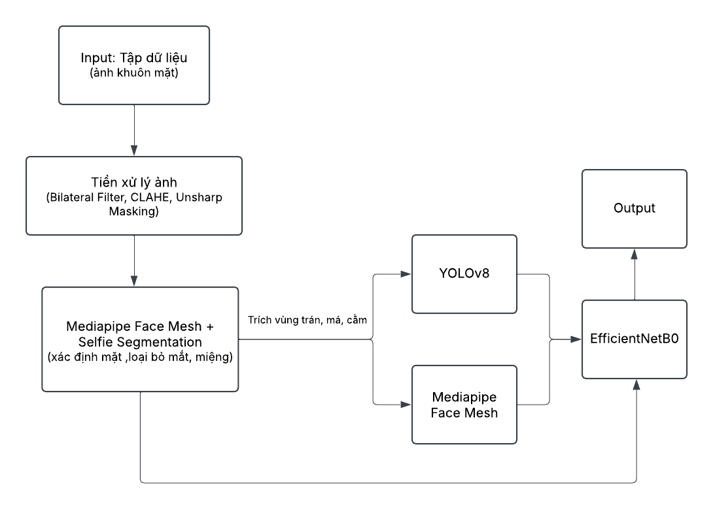

Quy trình khái quát:

1. **Input:** ảnh khuôn mặt tương đối rõ, đủ sáng và có góc nhìn phù hợp.
2. **Face preprocessing:** phát hiện/cắt khuôn mặt bằng MediaPipe; kết hợp Face Mesh và Selfie Segmentation để loại nền, che vùng mắt/miệng.
3. **Image enhancement:** bilateral filter để giảm nhiễu, CLAHE để tăng tương phản cục bộ và unsharp masking để làm sắc nét.
4. **Region extraction:** trích xuất vùng má, trán và cằm bằng landmark MediaPipe hoặc detector YOLOv8.
5. **Classification:** chuẩn hóa ảnh về `224 × 224`, đưa vào EfficientNet-B0 Lite.
6. **Output:** dự đoán một trong ba nhãn `dry`, `normal`, `oily` cùng xác suất lớp.

### Ví dụ tiền xử lý và vùng da

| Ảnh đầu vào | Sau xử lý / vùng da |
|---|---|
| 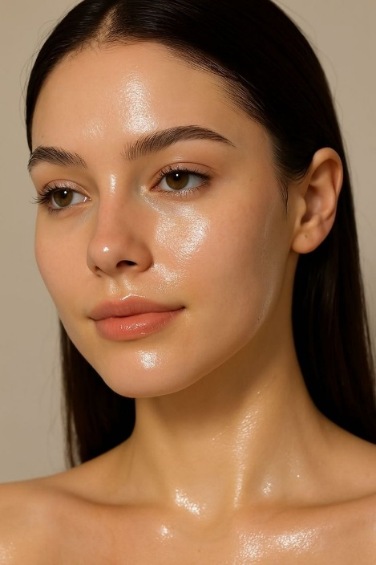 | 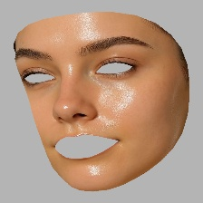 |

Các hình minh họa được trích từ báo cáo đồ án. Chất lượng kết quả phụ thuộc vào ảnh đầu vào; ảnh bị che khuất, thiếu sáng hoặc nghiêng nhiều có thể làm giảm độ tin cậy.

## Kết quả benchmark

Các số liệu dưới đây được tổng hợp từ báo cáo thực nghiệm của dự án. Mô hình phân loại sử dụng cùng họ kiến trúc EfficientNet-B0 Lite, trong khi cách xử lý/trích xuất vùng đầu vào thay đổi.

### So sánh tổng quan

| Cấu hình | Validation accuracy được báo cáo | Accuracy trong classification report | Số mẫu trong report |
|---|---:|---:|---:|
| Không trích xuất vùng da riêng biệt | 92.37% | 92% | 1,840 |
| MediaPipe Face Mesh trích xuất vùng | 93.16% | 93% | 1,169 |
| YOLOv8 trích xuất vùng | **95.02%** | **95%** | 1,230 |

**Kết quả tốt nhất được báo cáo:** YOLOv8 + EfficientNet-B0 Lite, với validation accuracy **95.02%**. Classification report của cấu hình này ghi nhận precision/recall/F1-score macro-average đều xấp xỉ **0.95**.

> **Cách đọc benchmark:** validation accuracy và accuracy trong classification report là các số liệu được báo cáo ở những phần đánh giá khác nhau. Số mẫu của classification report cũng khác nhau giữa các cấu hình (1,840 / 1,169 / 1,230), vì vậy không nên xem đây là phép so sánh hoàn toàn cùng điều kiện. Các con số phản ánh kết quả trong báo cáo đồ án, không phải cam kết hiệu năng trên dữ liệu mới ngoài thực tế.

### Learning curves

#### Không trích xuất vùng da riêng biệt
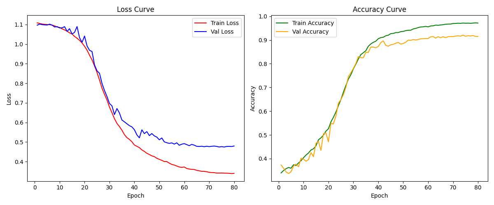

#### Trích xuất vùng bằng MediaPipe
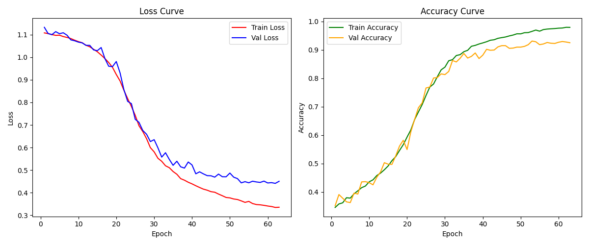

#### Trích xuất vùng bằng YOLOv8
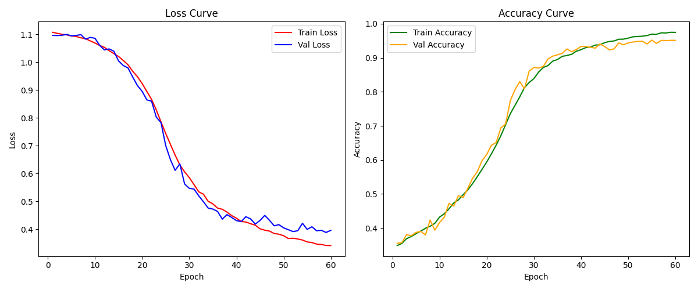

### Confusion matrix

#### Không trích xuất vùng da riêng biệt
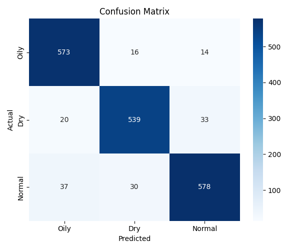

#### Trích xuất vùng bằng MediaPipe


#### Trích xuất vùng bằng YOLOv8
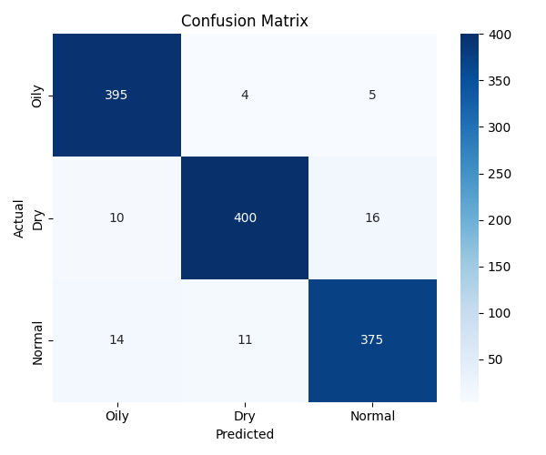

### Classification report theo từng lớp

**Baseline — không trích xuất vùng da riêng biệt**

| Lớp | Precision | Recall | F1-score | Support |
|---|---:|---:|---:|---:|
| Oily | 0.91 | 0.95 | 0.93 | 603 |
| Dry | 0.92 | 0.91 | 0.92 | 592 |
| Normal | 0.92 | 0.90 | 0.91 | 645 |
| **Accuracy** |  |  | **0.92** | **1,840** |
| Macro avg | 0.92 | 0.92 | 0.92 | 1,840 |
| Weighted avg | 0.92 | 0.92 | 0.92 | 1,840 |

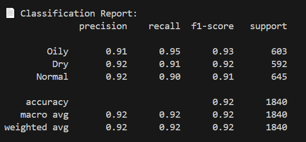

**MediaPipe Face Mesh — trích xuất vùng da**

| Lớp | Precision | Recall | F1-score | Support |
|---|---:|---:|---:|---:|
| Oily | 0.90 | 0.96 | 0.93 | 379 |
| Dry | 0.93 | 0.91 | 0.92 | 391 |
| Normal | 0.93 | 0.94 | 0.94 | 399 |
| **Accuracy** |  |  | **0.93** | **1,169** |
| Macro avg | 0.93 | 0.93 | 0.93 | 1,169 |
| Weighted avg | 0.93 | 0.93 | 0.93 | 1,169 |

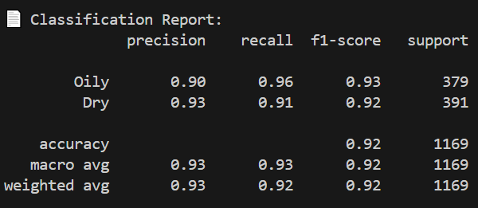

**YOLOv8 — trích xuất vùng da**

| Lớp | Precision | Recall | F1-score | Support |
|---|---:|---:|---:|---:|
| Oily | 0.94 | 0.98 | 0.96 | 404 |
| Dry | 0.96 | 0.94 | 0.95 | 426 |
| Normal | 0.95 | 0.94 | 0.94 | 400 |
| **Accuracy** |  |  | **0.95** | **1,230** |
| Macro avg | 0.95 | 0.95 | 0.95 | 1,230 |
| Weighted avg | 0.95 | 0.95 | 0.95 | 1,230 |

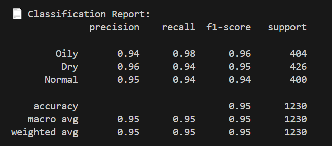

## Dữ liệu

Báo cáo đồ án mô tả hai nguồn dữ liệu công khai:

- **Oily, Dry and Normal Skin Types Dataset (Kaggle):** 3,152 ảnh được gán nhãn `dry`, `oily`, `normal`.
- **Skin Type Dataset by Otar (Roboflow Universe):** 4,093 ảnh được gán nhãn cho ba loại da.

Tổng số ảnh được nêu theo nguồn là **7,245 ảnh trước các bước làm sạch, lọc và chia tập**. Đây không nhất thiết là số ảnh cuối cùng được dùng trong từng thí nghiệm. Vui lòng xem điều khoản của từng nguồn dữ liệu trước khi tái sử dụng.

Cấu trúc dataset mà bộ phân loại mong đợi:

```text
<dataset-root>/
├── train/
│   ├── dry/
│   ├── normal/
│   └── oily/
├── valid/
│   ├── dry/
│   ├── normal/
│   └── oily/
└── test/                  # Không bắt buộc với train.py hiện tại
    ├── dry/
    ├── normal/
    └── oily/
```

Các định dạng ảnh được hỗ trợ: `.jpg`, `.jpeg`, `.png`, `.bmp`.

Mapping nhãn trong `datasets/skintype.py`:

| Nhãn | Class ID |
|---|---:|
| `dry` | 0 |
| `normal` | 1 |
| `oily` | 2 |

## Công nghệ sử dụng

- **Python 3.10+** (môi trường phát triển được mô tả dùng Python 3.12 trên Windows)
- **PyTorch** — huấn luyện và suy luận mô hình phân loại
- **EfficientNet-B0 Lite tự cài đặt** — backbone phân loại
- **MediaPipe Face Mesh / Selfie Segmentation** — landmark khuôn mặt, tạo mask và loại nền
- **YOLOv8 / Ultralytics** — phát hiện vùng má, trán và cằm
- **OpenCV** — xử lý ảnh, bilateral filter, CLAHE, unsharp masking
- **scikit-learn** — classification report và confusion matrix
- **TensorBoard** — theo dõi quá trình huấn luyện

## Cấu trúc thư mục

```text
.
├── mediapipe_region/
│   └── region_extractor.py       # Cắt forehead, cheeks, chin theo landmark
├── YOLO/
│   ├── yolo_labeling/
│   │   ├── create_yolo_label.py  # Tạo nhãn YOLO từ Face Mesh
│   │   ├── train_yolo.py         # Huấn luyện YOLOv8
│   │   └── data.yaml
│   ├── scripts/
│   │   └── predict_crop_yolo.py  # Phát hiện và cắt vùng bằng YOLO
│   └── combine.py                # Ghép các vùng theo chiều dọc
└── skin_type_project/
    ├── data_test/                # Dữ liệu đầu vào mẫu (nếu có)
    ├── test_crop/
    │   ├── new_crop.py           # Cắt mặt, che mắt/miệng, làm nền xám
    │   └── load_crop_new.py      # Chạy batch
    ├── datasets/
    │   └── skintype.py           # Dataset và tiền xử lý
    ├── models/
    │   └── efficientnet_model.py # EfficientNet-B0 Lite tự cài đặt
    ├── utils/
    │   └── transforms.py
    ├── train.py                  # Huấn luyện bộ phân loại
    ├── eluvate.py                # Suy luận một ảnh
    └── requirements.txt
```

## Cài đặt môi trường

Ví dụ trên Windows PowerShell:

```powershell
cd D:\skin_type\skin_type_project
python -m venv .venv
.\.venv\Scripts\Activate.ps1
python -m pip install --upgrade pip
pip install -r requirements.txt
pip install pandas seaborn scikit-learn ultralytics tensorboard
```

Nếu dùng GPU, cài bản PyTorch tương thích với CUDA của máy theo hướng dẫn chính thức của PyTorch trước khi cài các package còn lại. Máy chỉ có CPU vẫn có thể chạy, nhưng thời gian huấn luyện/suy luận có thể lâu hơn.

**Lưu ý dependency:** theo ghi chú trong repository, `requirements.txt` chưa liệt kê trực tiếp `pandas`, `seaborn`, `scikit-learn` và `ultralytics`, dù một số script có thể cần chúng. Hãy kiểm tra lại file dependency của phiên bản code bạn đang dùng.

## Chạy pipeline MediaPipe

### 1. Cắt khuôn mặt và làm sạch ảnh

Đặt dữ liệu trong `skin_type_project/data_test/` theo cấu trúc dataset, sau đó chạy:

```powershell
cd D:\skin_type\skin_type_project\test_crop
python load_crop_new.py
```

`advanced_face_crop_with_cleaning()` dùng Face Mesh để tìm contour khuôn mặt, che vùng mắt/miệng, dùng Selfie Segmentation để tách nền, thay nền bằng màu xám, thêm padding mặc định 40 pixel và resize về `224 × 224`.

Kết quả theo README/code hiện tại được ghi vào `skin_type_project/eyes_mouth/<split>/<label>/`. Ảnh không phát hiện được khuôn mặt sẽ bị bỏ qua và in cảnh báo.

### 2. Trích xuất ba vùng bằng landmark

```powershell
cd D:\skin_type\skin_type_project
python ..\mediapipe_region\region_extractor.py
```

Script đọc `eyes_mouth/`, cắt vùng `forehead`, `cheeks`, `chin`, ghép dọc, resize vừa trong khung `224 × 224` và lưu vào `crop_media_new2/`.

Đường dẫn trong khối `__main__` là đường dẫn tương đối; cần chạy từ đúng thư mục hoặc sửa các tham số đầu vào/đầu ra của `batch_process()`.

## Chạy pipeline YOLOv8

### 1. Tạo nhãn YOLO

Cấu trúc dataset YOLO:

```text
YOLO/dataset_yolo/
├── images/
│   ├── train/<skin-label>/
│   └── valid/<skin-label>/
└── labels/
    ├── train/<skin-label>/
    └── valid/<skin-label>/
```

Mỗi file nhãn dùng định dạng:

```text
class_id x_center y_center width height
```

`create_yolo_label.py` dùng MediaPipe Face Mesh để tạo bounding box. Class ID theo báo cáo code:

```text
0 = cheek
1 = chin
2 = forehead
```

Chạy tạo nhãn:

```powershell
cd D:\skin_type\YOLO
python yolo_labeling/create_yolo_label.py
```

### 2. Huấn luyện YOLOv8

```powershell
cd D:\skin_type\YOLO
python yolo_labeling/train_yolo.py
```

Cấu hình mặc định được mô tả: YOLOv8n, 100 epochs, ảnh `640 × 640`, batch size 16, thiết bị `cuda`. Nếu không có GPU, đổi `device='cuda'` thành `device='cpu'` trong `yolo_labeling/train_yolo.py`.

### 3. Dự đoán và cắt vùng

```powershell
cd D:\skin_type\YOLO
python scripts/predict_crop_yolo.py
```

Script đọc trọng số mặc định `YOLO/runs/detect/yolov8_face_parts/weights/best.pt` và lưu ảnh crop vào `YOLO/crop_yolo/<split>/<region>/<label>/`.

**Lưu ý tên lớp:** script tạo nhãn dùng `cheek`, trong khi script dự đoán có thể dùng `cheeks`. Hãy thống nhất tên thư mục/class mapping trước khi nối các bước tự động.

## Huấn luyện EfficientNet-B0 Lite

Theo cấu hình được mô tả trong project:

- Input: `224 × 224`
- Batch size: 32
- Tối đa: 80 epochs
- Optimizer: AdamW
- Learning rate: `0.001`
- Weight decay: `1e-4`
- Scheduler: OneCycleLR
- Loss: CrossEntropyLoss với label smoothing `0.1`
- Early stopping: dừng sau 5 epochs không cải thiện validation accuracy
- Checkpoint tốt nhất được lưu tự động
- TensorBoard log: `runs/efficientnet_b0_skin`

`train.py` hiện dùng đường dẫn dataset cố định `crop_yolo_new2` và hai split `train`, `valid`. Đảm bảo thư mục tồn tại tương đối với working directory hoặc chỉnh đường dẫn trong script.

```powershell
cd D:\skin_type\skin_type_project
python train.py --save-model-path best_model.pth --output-plot training_curve.png
```

Đầu ra dự kiến gồm:

- File trọng số theo `--save-model-path`
- Biểu đồ theo `--output-plot`
- `confusion_matrix.png`
- Classification report trên terminal
- TensorBoard logs tại `runs/efficientnet_b0_skin`

Mở TensorBoard:

```powershell
tensorboard --logdir runs/efficientnet_b0_skin
```

## Dự đoán một ảnh

`eluvate.py` hiện tải trọng số `best_model2.pth` và đọc ảnh từ biến `image_path` được khai báo trong file. Cập nhật hai đường dẫn này theo môi trường của bạn:

```python
model_path = "best_model2.pth"
image_path = "crop_yolo_new2/valid/dry/example.jpg"
```

Sau đó chạy:

```powershell
cd D:\skin_type\skin_type_project
python eluvate.py
```

Kết quả là nhãn `dry`, `normal` hoặc `oily` cùng xác suất của lớp được chọn. Thứ tự nhãn trong script suy luận phải khớp với mapping trong dataset.

## Kiến trúc EfficientNet-B0 Lite

Mô hình trong `models/efficientnet_model.py` là biến thể EfficientNet-B0 Lite tự cài đặt, không sử dụng trực tiếp pretrained EfficientNet từ `torchvision`. Các thành phần chính:

- Stem convolution
- MBConv blocks
- Squeeze-and-Excitation (SE)
- DropPath trong quá trình huấn luyện
- Global average pooling
- Dropout `0.5`
- Fully connected layer đầu ra 3 lớp

Mô hình trả về logits; bước suy luận áp dụng softmax để chuyển logits thành xác suất.

## Hạn chế và hướng phát triển

- Mô hình chỉ phân loại ba nhóm `dry`, `normal`, `oily`; chưa xử lý da hỗn hợp, da nhạy cảm hoặc tình trạng bệnh lý da.
- Chất lượng ảnh, ánh sáng, góc mặt, tóc/phụ kiện che khuất và sự đa dạng dữ liệu có thể ảnh hưởng kết quả.
- Dataset chưa đại diện đầy đủ mọi độ tuổi, giới tính, sắc tố da và điều kiện chụp.
- Kết quả chưa được đánh giá lâm sàng bởi chuyên gia da liễu.
- Nên đánh giá thêm trên tập test độc lập, kiểm tra rò rỉ dữ liệu giữa train/validation/test và báo cáo confidence intervals nếu cần so sánh nghiêm ngặt.
- Có thể mở rộng tập dữ liệu, bổ sung lớp da hỗn hợp, tối ưu inference và xây dựng giao diện web/mobile.

## Tài liệu tham khảo và nguồn dữ liệu

- [Oily, Dry and Normal Skin Types Dataset — Kaggle](https://www.kaggle.com/datasets/shakyadissanayake/oily-dry-and-normal-skin-types-dataset)
- [Ultralytics YOLO documentation](https://docs.ultralytics.com/)
- [MediaPipe documentation](https://ai.google.dev/edge/mediapipe/solutions/guide)
- [PyTorch documentation](https://pytorch.org/docs/stable/index.html)

Các hình benchmark trong thư mục `assets/` được trích từ báo cáo đồ án `KLTN_Skintype.docx`. Các số liệu được ghi lại theo báo cáo thực nghiệm; hãy chạy lại code trên cùng một tập test cố định nếu cần benchmark có thể tái lập.

## License

Repository chưa có file `LICENSE` theo thông tin hiện có. Bổ sung giấy phép phù hợp trước khi phân phối hoặc sử dụng thương mại. Đồng thời kiểm tra giấy phép của các dataset, model và thư viện bên thứ ba.
